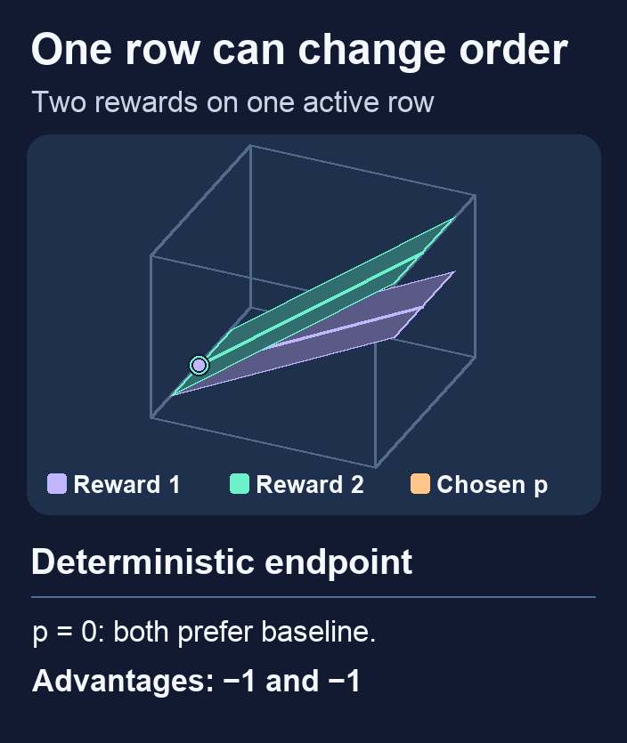

# Policy-order equivalence across all transition kernels

  

A finite algebraic test determines whether two rewards give identical weak orders of stationary randomized policies under every transition kernel of a finite discounted Markov decision process. It tests polynomial minors and signs on every face of the kernel domain, including boundary ties.

[Read the paper](paper/manuscript.pdf) · [LaTeX source](paper/manuscript.tex) · [Proof outline](proof/PROBLEM_AND_PROOF.md) · [Run the replay](REPRODUCIBILITY.md)

## Deterministic transitions can miss a reversal

In the example, only one state–action row carries reward. The advantages 2p − 1 and 3p − 1 agree in sign at the two deterministic endpoints. At p = 2/5 the first reward prefers the baseline and the second prefers the alternative. A separate pair agrees for p > 0 but disagrees on a tie at p = 0.

[Download the offline explorer](https://raw.githubusercontent.com/DannyExperiments/all-kernel-policy-order-equivalence/refs/tags/v1.0.0/visualization/transition-reversals-explorer.zip), extract it, and open index.html. Change the successor probability and rotate the plot. [Figure guide](visualization/README.md)

## Prior results and the state–action case

The paper addresses Skalse and Abate's all-kernel question in Appendix A.7. Their fixed-kernel characterization and the published separation from stronger trajectory-distribution equivalence are prior results. When rewards depend only on state and action and at least two actions are available, this note proves the exact positive affine characterization using at most |S| + 1 predetermined deterministic kernels. [Original question](https://arxiv.org/pdf/2411.15951v1#page=94) · [Pinned Q717](https://github.com/10m-u/open-problems-catalog/blob/ca8d4d44ba3db527f19f28928c240168f545ecfe/problems/mathematics/optimization-operations-research.md#q717)

[Mathematical audit](audits/public_safe_reports/MATHEMATICAL_AUDIT.md) · [Literature audit](audits/public_safe_reports/LITERATURE_AUDIT.md) · [Scope](CLAIM_SCOPE_AND_LIMITATIONS.md) · [AI disclosure](AI_DISCLOSURE.md) · [Status](STATUS.md)

[Release v1.0.0](https://github.com/DannyExperiments/all-kernel-policy-order-equivalence/releases/tag/v1.0.0) · [Version DOI](https://doi.org/10.5281/zenodo.24572485) · [Citation](CITATION.cff)
